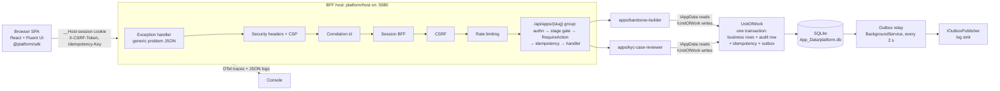

# Barebone — a security-first internal-tool platform (prototype)

**Barebone** is a local, runnable prototype of a shared platform for internal tools at a regulated (US, Series C) fintech.
The platform (`platform/`) owns every security control once — sign-in, sessions, CSRF, authorization, staged rollout,
atomic writes, idempotency, tamper-evident audit, PII masking, telemetry — so that a new internal tool ships by adding
**only** a folder under `apps/<slug>/` (manifest, policy, entities, endpoints, pages).

Two apps run on it:

- **Barebone Builder** (`apps/barebone-builder`): the intake + approval portal. Staff request a tool, a Builder approves
  it (never their own request), the Builder generates its `platform.yaml` and moves it through stages
  `builder-only` → `demo` → `live`.
- **KYC Case Reviewer** (`apps/kyc-case-reviewer`): the demo app. Analysts review Know-Your-Customer (identity
  verification) cases and recommend; Senior Reviewers decide, under **maker-checker** (the person who prepared a case
  can never be the one who approves it).

All data is **synthetic** (fake names, `@example.test` emails, obviously-fake last-4 digits). There are **no card numbers
anywhere** (zero-PAN; PAN = Primary Account Number). The binding design contract is
[`docs/prototype-plan.md`](docs/prototype-plan.md); this README is the reviewer's entry point.

## Quick start

Prerequisites: .NET 10 SDK, Node 24 + npm, `openssl`, `python3` (only for the tamper demo).

```bash
scripts/dev.sh
# open http://localhost:5080
```

`scripts/dev.sh` (1) creates the gitignored `.env` with a random `Platform__AuditChainKey` (`openssl rand -hex 32`) if
missing, (2) exports it, (3) runs `npm ci` if needed and `npm run build` (SPA → `platform/host/wwwroot/`), and
(4) runs `dotnet run --project platform/host` on `http://localhost:5080` (one origin, real CSP).
For frontend hot reload, run `npm run dev` in a second terminal (Vite on `:5173`, proxies `/api` and `/health` to `:5080`).
`.env.example` documents the only required setting; it holds an empty placeholder, never a value.

Dev users (from [`config/dev-directory.json`](config/dev-directory.json); a stand-in for Entra ID groups — pick one on
the `/login` page):

| id | Name | Roles | Used in the demo for |
|---|---|---|---|
| `u-alice` | Alice Ops | Requester | requests the KYC app; demo viewer |
| `u-bob` | Bob Builder | Builder | builder-only access |
| `u-bianca` | Bianca Builder | Builder | approves Alice's intake, sets stages |
| `u-carol` | Carol Analyst | KYC Analyst | reviews a case, reveals PII, recommends |
| `u-dan` | Dan Analyst | KYC Analyst | second analyst (sees only own/unassigned cases) |
| `u-erin` | Erin Senior | KYC Senior Reviewer | final decision |
| `u-grace` | Grace Dual | KYC Analyst, KYC Senior Reviewer | maker-checker: blocked from deciding what she prepared |
| `u-frank` | Frank Auditor | Auditor | audit trail + chain verification |
| `u-mallory` | Mallory Outsider | (none) | denied everywhere |

## Architecture



## Folder layout

```
Devin.slnx  Directory.Build.props  global.json  .editorconfig  .gitleaks.toml  .env.example
package.json  tsconfig.json  eslint.config.js  vitest.config.ts      single npm project at the repo root
config/dev-directory.json          dev users + roles
platform/backend/Platform/         Barebone.Platform SDK; Abstractions/ is the public C# API apps may use
platform/host/                     Barebone.Platform.Host (BFF): discovers apps, serves the SPA
platform/web/                      React shell; src/sdk/ is the public TS API (@platform/sdk)
apps/barebone-builder/             Builder portal (an app on the platform, registration: bootstrap)
apps/kyc-case-reviewer/            demo app (registration: intake)
tests/Platform.Tests/  tests/web/  xUnit (+ WebApplicationFactory) and Vitest tests
scripts/                           dev.sh, scaffold-app.sh (+ templates/app), tamper-audit.py
.github/workflows/ci.yml           CI
docs/prototype-plan.md             binding contract
```

**Rule: apps never edit `platform/`.** Apps never reference each other, and `platform/` contains no app-specific (e.g.
KYC) code or strings. The host finds apps with a csproj glob (`../../apps/*/backend/*.csproj`) and the SPA with
`import.meta.glob('../../../apps/*/web/index.tsx')`, so adding an app needs no platform edit.

## Security model

| Control | How it works here | Where |
|---|---|---|
| BFF session cookie | Backend-for-Frontend: the browser never holds a token. Login sets `__Host-session` (HttpOnly, Secure, SameSite=Strict, Path=/), a 256-bit random id mapped to a server-side `ISessionStore`; idle 30 min / absolute 8 h; id rotated on login. | plan §3.2.4 |
| CSRF | Every non-GET/HEAD/OPTIONS request must send `X-CSRF-Token` matching the session's token (from `GET /api/session`; before login the `__Host-csrf` cookie) or gets 403. | §3.2.5 |
| Deny-by-default policy | Each endpoint declares `RequireAction("…")`; `IAuthorizer` evaluates the app's `policy.yaml`. No matching allow ⇒ 403 `no-matching-rule`; any matching deny wins; endpoints without `RequireAction` are denied. Denials are audited. | §3.5 |
| Maker-checker | Deny rules on `resource.requesterId == $user.id` (Builder approval) and `resource.preparedBy == $user.id` (KYC decision), reason `maker-checker`. | §3.5, §4 |
| Staged access | From the **catalog**, not the file: `builder-only` ⇒ Builders; `demo` ⇒ Builders + the requester; `live` ⇒ only the `accessList`. Admitted users get pseudo-roles `platform:builder` / `platform:demo-viewer` (read-only grants). | §3.4 |
| Atomic UnitOfWork | `IUnitOfWork.ExecuteAsync` is the only write path: business change + one audit row + idempotency record + outbox rows commit in one SQLite transaction or not at all. Apps get no `DbContext`. | §3.6 |
| Idempotency | App mutations require `Idempotency-Key`; same key + same body ⇒ stored response with `Idempotency-Replayed: true` (handler not re-run); different body ⇒ 422; concurrent duplicate ⇒ 409. | §3.6 |
| Outbox | Events are written in the same transaction and relayed every 2 s; a conditional `WHERE SentAt IS NULL` update makes each row publish once even with concurrent relays. | §3.6 |
| Tamper-evident audit | Append-only (no update/delete API). Each row's `hash = HMAC-SHA256(Platform:AuditChainKey, canonical(fields) + prevHash)`; `GET /api/platform/audit/verify` recomputes the chain and returns `{valid, checked, firstBrokenId, reason}`. | §3.6 |
| Manifest fail-closed | Every `platform.yaml` / `policy.yaml` is validated at startup; any error (bad slug, unknown enum, `cardData` ≠ `none`, PII below `confidential`, `"*"` access list on confidential/restricted, unknown policy role) ⇒ host refuses to start. | §3.7 |
| Secrets | None in code or Git. `Platform:AuditChainKey` comes from env / `dotnet user-secrets`; startup fails if missing, < 32 chars or a placeholder. gitleaks (default rules + zero-PAN + `AuditChainKey` rules) scans full history in CI. | §3.9, `.gitleaks.toml` |
| Security headers / CSP | `default-src 'self'; script-src 'self'` (no inline scripts), `frame-ancestors 'none'`, HSTS, nosniff, `Referrer-Policy: no-referrer`, `X-Frame-Options: DENY`, COOP, Permissions-Policy. `'unsafe-inline'` only for styles (Fluent UI injects style tags). | §3.2.2 |
| Rate limiting | Login 20/min per IP; mutations 120/min per user; 429 problem JSON. | §3.2.6 |
| PII masking + zero-PAN | `[Pii]` / manifest `piiFields` are masked in API responses and audit diffs (`J*** D***`, `****-**-**`, `***-**-1234`); unmasking is an explicit, audited `reveal` (outcome `read`). Only SSN last-4 is stored. `cardData: none` is mandatory. | §3.6, §4 |
| Synthetic data only | `[Synthetic(...)]` + deterministic generator (Bogus inside the platform), `@example.test` emails, restricted apps get obviously-fake values. | §3.11 |
| Generic errors | RFC 7807 problem JSON `{type,title,status,correlationId}`; never stack traces. | §3.2.1 |
| Structured logging with redaction | JSON console logs; known sensitive keys redacted; PII never logged. | §3.10 |
| OTel + correlation id | OpenTelemetry tracing/logging; `X-Correlation-Id` accepted if `^[A-Za-z0-9-]{8,64}$` else generated, echoed, on the Activity, log scope and audit rows. | §3.2.3, §3.10 |
| Frontend hygiene | No tokens/PII in localStorage/sessionStorage; no `dangerouslySetInnerHTML`; `credentials: 'same-origin'`. | §5 |

## Demo script

Start fresh: `rm -f platform/host/App_Data/platform.db && scripts/dev.sh`, open `http://localhost:5080`.

1. **Alice requests the app.** Log in as **Alice Ops** (Requester). In Barebone Builder, create an intake: title
   "KYC Case Reviewer", slug `kyc-case-reviewer`, data classification `restricted`, access `write`, plus hours saved and
   users (the ROI panel computes payback live via `GET /api/apps/barebone-builder/roi`). Submit (`POST /intakes`).
2. **Self-approval is blocked.** Log in as **Bob Builder** — he can see it; Alice cannot approve her own request
   (`POST /intakes/{id}/approve` ⇒ 403 `maker-checker`; also audited).
3. **Bianca approves.** Log in as **Bianca Builder** and approve. The app is registered in the catalog at stage
   `builder-only`, its generated `platform.yaml` is shown (also at `GET /api/platform/catalog/kyc-case-reviewer`,
   field `manifestYaml`), and synthetic cases are seeded.
4. **Stage builder-only.** Alice opens KYC Case Reviewer ⇒ *Access denied* (403, audited). Bob ⇒ allowed (masked,
   read-only via `platform:builder`).
5. **Stage demo.** Bianca sets stage `demo` (`POST /apps/kyc-case-reviewer/stage`). Alice (the requester) can now view
   (masked, read-only via `platform:demo-viewer`).
6. **Stage live + access list.** Bianca sets stage `live` and the access list to
   `[u-carol, u-dan, u-erin, u-grace, u-frank]` (`PUT /apps/kyc-case-reviewer/access-list`). Alice and Bob are now
   denied.
7. **Carol reviews.** Log in as **Carol Analyst**: she sees only cases assigned to her or unassigned. Open one, assign
   to self, **reveal PII** (`POST /cases/{id}/reveal`; audited with outcome `read`), add a note, recommend `approve`
   ⇒ status `pending-senior-review`, `preparedBy = u-carol`.
8. **Maker-checker.** Log in as **Grace Dual** (Analyst + Senior). Prepare/recommend a case, then try to decide it
   ⇒ **403 `maker-checker`** (audited).
9. **Erin decides + idempotency.** Log in as **Erin Senior** and approve Carol's case ⇒ `approved`. Click
   **"resend same key"**: the same `Idempotency-Key` is replayed ⇒ same response, header `Idempotency-Replayed: true`,
   no second audit row.
10. **Frank audits.** Log in as **Frank Auditor**, open `/audit`: every success, denial and PII read is listed with its
    hash. Click **Verify audit chain** ⇒ `Chain valid (<n> rows)`.
11. **Tamper.** As a DB-level attacker: `scripts/tamper-audit.py` (default DB `platform/host/App_Data/platform.db`;
    `--id N`, `--column after|action`). It rewrites one row's `after` (e.g. flips `approved` → `rejected`) without
    being able to recompute the HMAC, and prints the row id.
12. **Detect.** Click **Verify audit chain** again ⇒ `Chain broken at row #<id>` (the id the script printed).

## Build your own tool on the barebone (engineer guide)

Worked example: `apps/kyc-case-reviewer`. You will only ever add files under `apps/<slug>/`.

**1. Scaffold.** `scripts/scaffold-app.sh <slug> ["Display Name"]` (slug `^[a-z][a-z0-9-]{2,40}$`) creates, from
`scripts/templates/app/`:

```
apps/<slug>/platform.yaml                  manifest (stage builder-only, registration intake, cardData none)
apps/<slug>/policy.yaml                    deny-by-default policy with one allow rule
apps/<slug>/backend/<Assembly>.csproj      references Barebone.Platform; copies the YAML files to output
apps/<slug>/backend/<Pascal>App.cs         IPlatformApp: ConfigureModel, MapEndpoints (GET + RequireAction), SeedAsync
apps/<slug>/backend/<Pascal>Item.cs        one sample entity with [Synthetic] attributes
apps/<slug>/web/index.tsx                  AppModule (default export) using @platform/sdk
```

and runs `dotnet sln Devin.slnx add` (solution folder `apps`). Naming follows the existing apps:
`kyc-case-reviewer` ⇒ assembly/namespace `Kyc.CaseReviewer`, class `KycCaseReviewerApp`, tables `kyc_case_reviewer_*`.
The script refuses to overwrite an existing folder and fails if anything under `platform/` changed.

**2. Fill in `platform.yaml`** — validated at startup, **fail closed** (an invalid manifest stops the host):
`owner` (team + `@example.test` email), `businessOwner`, `dataClassification` (`public|internal|confidential|restricted`),
`access` (`read-only|write`), `roles` (directory roles your policy uses), `piiFields` (requires `confidential` or
higher), `auditedFields`, `stage` (initial stage on registration, normally `builder-only`), `cardData: none`,
`backend.assembly`. KYC uses `restricted`, `write`, `piiFields: [customerName, dateOfBirth, ssnLast4]`.

**3. Write `policy.yaml`** — roles → actions, optional conditions, deny rules. Anything not allowed is denied. KYC's
maker-checker rule:

```yaml
  - action: case.decide
    effect: deny
    roles: ["*"]
    when: { allOf: [ { attr: resource.preparedBy, op: eq, value: $user.id } ] }
    reason: maker-checker
```

Conditions use `resource.<attr>` from the endpoint's `ResourceLoader`, ops `eq|neq|in|notIn|isNull|notNull`, values
literal / list / `$user.id`. Grant `platform:builder` / `platform:demo-viewer` read-only actions so the app can be
previewed in `builder-only` / `demo`.

**4. Write entities, endpoints and pages.**
- Entities: plain classes registered in `ConfigureModel` (table names prefixed with the slug); `[Synthetic(SyntheticKind.X)]`
  drives the seeder, `[Pii]` marks fields masked in audit diffs.
- Endpoints: `MapEndpoints(group)` on the platform-created `/api/apps/<slug>` group. Every endpoint calls
  `.RequireAction("<action>", loader)`; reads use `IAppData.Query<T>()`; writes go through
  `IUnitOfWork.ExecuteAsync(new UnitOfWorkContext(action, resourceType, id), (scope, ct) => …)` and return
  `Results.Ok(dto)` (that body is what idempotent replays return). No `DbContext`, no `SaveChanges`, no audit code.
- Pages: `web/index.tsx` default-exports an `AppModule { slug, displayName, routes }`; import only from `@platform/sdk`
  (`api`, `useSession`, `Page`, `MaskedValue`, `AccessDenied`, …). `api.post` adds CSRF + idempotency headers for you.

**5. Register through the Builder.** Submit an intake (slug = folder name) ⇒ a different Builder approves (catalog
entry, stage `builder-only`; registration checks your manifest's `access` matches and its classification is ≥ the
approved one) ⇒ `demo` (requester previews) ⇒ `live` + access list.

**6. What you get for free without writing security code**

| You get | Provided by |
|---|---|
| SSO-ready sign-in, BFF session cookie (`__Host-session`) | platform host (`IIdentityProvider` seam) |
| CSRF protection | platform pipeline + `@platform/sdk` `api` |
| Deny-by-default authorization | `RequireAction` + `IAuthorizer` + your `policy.yaml` |
| Maker-checker | one deny rule in `policy.yaml` |
| Staged access (builder-only → demo → live + access list) | catalog + stage gate |
| Atomic writes | `IUnitOfWork` |
| Idempotency (replay, 422 on reuse, 409 in flight) | app route group filter |
| Hash-chained audit of every write, denial and PII read + verify | `IUnitOfWork` / audit writer, `/api/platform/audit/verify` |
| PII masking | `[Pii]` / `piiFields`, `PiiMask` |
| Security headers + CSP | platform pipeline |
| Rate limiting | platform pipeline |
| Telemetry + correlation id | OpenTelemetry + correlation middleware |
| Synthetic data | `[Synthetic]` + `ISyntheticDataGenerator` |
| CI: build (`-warnaserror`), format, tests, gitleaks, vulnerable-package and `npm audit` gates | `.github/workflows/ci.yml` |

**7. Prove you didn't touch the platform.**

```bash
git diff --stat main -- platform/         # must print nothing
git diff --stat main -- apps/<slug>/      # lists only your app's files
```

(Your diff also touches `Devin.slnx` from the scaffold step, which is expected.)

## Seams to production

| Prototype | Production |
|---|---|
| Dev user picker (`DevIdentityProvider`) | Entra ID OIDC via the BFF (same session/cookie model) |
| YAML policy engine (`IAuthorizer`) | Cerbos PDP (policy decision point) + Entra ID Governance (access reviews) |
| SQLite | Azure SQL with ledger tables |
| HMAC hash chain | SQL ledger digests to Azure Confidential Ledger + WORM (write-once) blob storage |
| env / `dotnet user-secrets` | Azure Key Vault + workload identity |
| Log outbox publisher (`IOutboxPublisher`) | Azure Service Bus Premium |
| In-memory session store (`ISessionStore`) | Distributed session store |
| Console OTel | OTel Collector → Datadog |
| Catalog table | Ledger-backed catalog |
| Local host | Private AKS (Azure Kubernetes Service) |

## Testing and CI

Locally (same commands CI runs):

```bash
# backend
dotnet restore Devin.slnx
dotnet build Devin.slnx -warnaserror --no-restore
dotnet format Devin.slnx --verify-no-changes --no-restore
Platform__AuditChainKey="$(openssl rand -hex 32)" dotnet test Devin.slnx --no-build
dotnet list Devin.slnx package --vulnerable --include-transitive   # must report no vulnerable packages
# frontend
npm ci && npm run lint && npm run typecheck && npm test && npm run build && npm audit --audit-level=high
# secrets + hygiene
gitleaks git --config .gitleaks.toml --redact -v
actionlint && shellcheck scripts/*.sh
```

`.github/workflows/ci.yml` runs on every pull request and push with `permissions: contents: read`, actions pinned to
full commit SHAs and `persist-credentials: false`. Jobs: **backend** (restore, build `-warnaserror`, format, test with
a per-run random `Platform__AuditChainKey`, vulnerable-package gate), **frontend** (Node 24 + npm cache, `npm ci`,
lint, typecheck, test, build, `npm audit --audit-level=high`), **secrets** (gitleaks pinned release binary, SHA-256
verified, full history), **hygiene** (actionlint pinned + verified, shellcheck). NuGet audit warnings are errors
(`Directory.Build.props`).

**Branch protection:** `main` requires a pull request with at least 1 human review and passing CI; no direct pushes.
